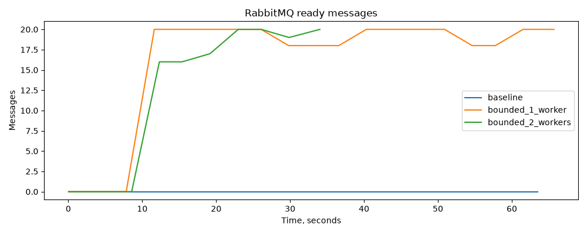
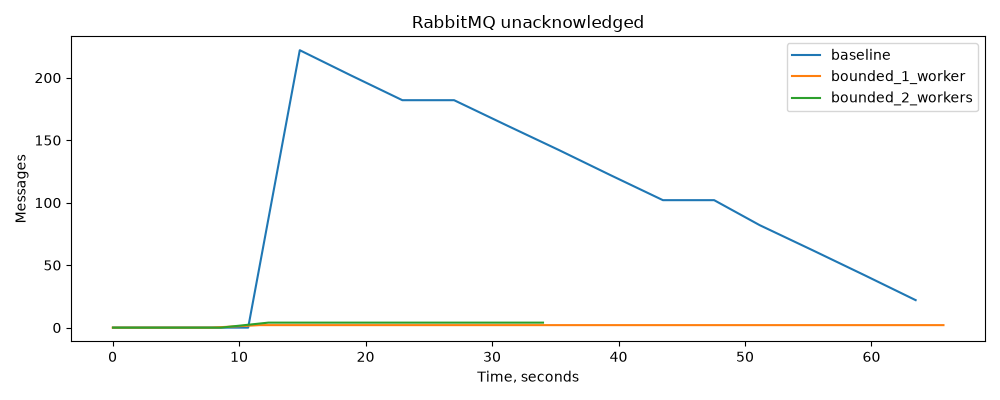
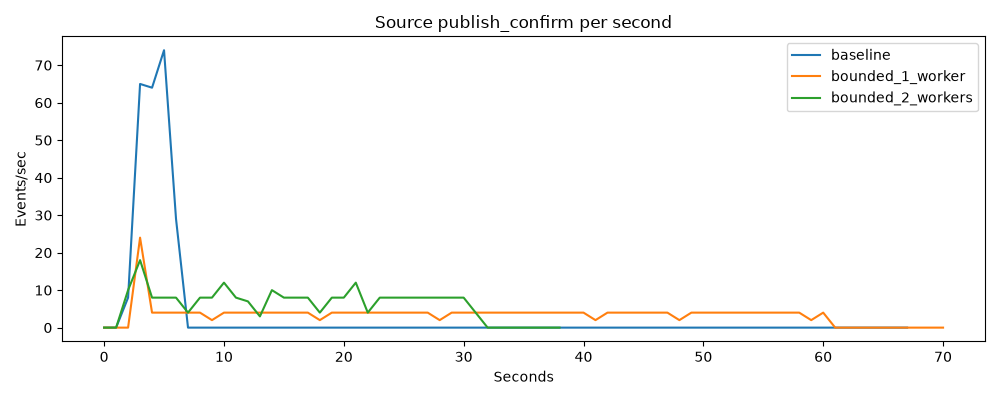
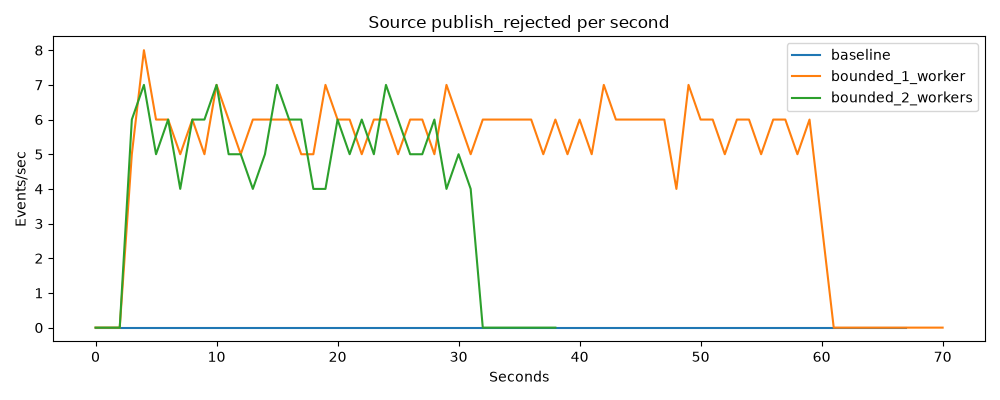
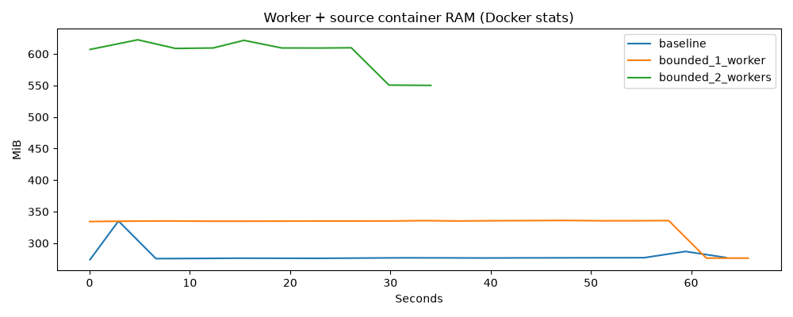
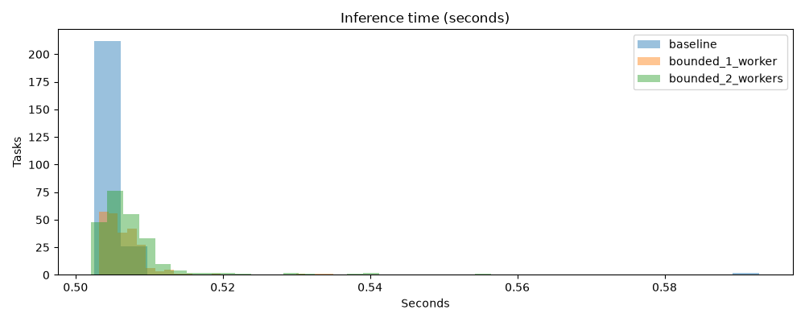
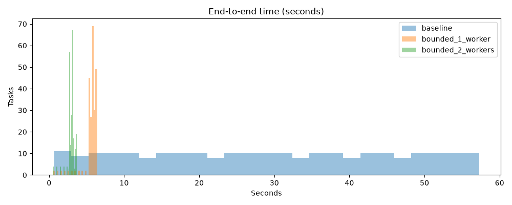

# Issue Intelligence Platform

**Issue Intelligence Platform** — платформа для интеллектуальной обработки сообщений о программных ошибках (*issue triage*). Она преобразует текст bug report в прогноз приоритета, управляет версиями ML-моделей и предоставляет асинхронную обработку отдельных запросов и больших наборов задач.

Сейчас реализован основной сценарий: **классификация поля `Priority` по `Summary` и `Description`**. Обучение и эксперименты отслеживаются в MLflow; рабочая модель выбирается через Model Registry; запросы обрабатываются независимыми воркерами через RabbitMQ, а состояние и результаты сохраняются в PostgreSQL.

Платформа развивается в сторону более широкого анализа программных ошибок: поиска похожих инцидентов, рекомендаций по устранению проблем и интеграции с инструментами разработчика. **Эти возможности пока относятся к планам развития, а не к работающему API.**

## Содержание

- [Зачем нужен проект](#зачем-нужен-проект)
- [Что уже реализовано](#что-уже-реализовано)
- [Архитектура](#архитектура)
- [Данные, обучение и выбор модели](#данные-обучение-и-выбор-модели)
- [Быстрый старт](#быстрый-старт)
- [Работа с API](#работа-с-api)
- [Пакетная обработка](#пакетная-обработка)
- [Управление нагрузкой](#управление-нагрузкой)
- [Надёжность и обработка ошибок](#надёжность-и-обработка-ошибок)
- [Конфигурация](#конфигурация)
- [Тестирование и измерение производительности](#тестирование-и-измерение-производительности)
- [Эксплуатационные сценарии](#эксплуатационные-сценарии)
- [Структура репозитория и дальнейшее развитие](#структура-репозитория-и-дальнейшее-развитие)

## Зачем нужен проект

В системах разработки баг-репорты поступают из трекеров задач, логов, пользовательских обращений и других источников. По мере роста их количества ручная первичная сортировка становится дорогой и непоследовательной. Issue Intelligence Platform создаёт техническую основу для автоматизации этого процесса.

Для текущего сценария пользователь передаёт заголовок и описание ошибки, а классификатор предлагает категорию приоритета. **Прогноз помогает при первичной сортировке, но не заменяет решение инженера и не гарантирует правильный приоритет для любого проекта или домена.**

Помимо качества модели, важна эксплуатационная сторона ML-сервиса: как обработать большой файл с задачами, не перегрузить inference, восстановиться после сбоя и понять, какой версией модели получен результат. Поэтому в проекте разделены два контура:

1. **ML/MLOps:** подготовка данных, EDA, обучение, сравнение моделей, фиксация артефактов, версионирование и выбор рабочей модели.
2. **Inference/processing:** приём задач, очередь сообщений, параллельные воркеры, управление перегрузкой, повторные доставки, хранение результатов и мониторинг.

Такое разделение позволяет развивать модели и масштабировать обработку независимо, без необходимости выполнять inference внутри HTTP-запроса.

## Что уже реализовано

| Область | Возможности |
|---|---|
| Данные | Загрузка и подготовка GitBugs / Apache Cassandra, работа с полями `Summary`, `Description`, `Priority` |
| Анализ | EDA, распределения классов и длин текстов, сохранение отчётов и графиков в MLflow |
| Обучение | Baseline, TF-IDF + Logistic Regression, TF-IDF + LinearSVC |
| Оценка | Macro F1 как основная метрика; Accuracy, Weighted F1, классификационные отчёты и confusion matrix |
| MLflow | Experiments, Runs, Dataset Tracking, Artifacts, Model Registry и alias `champion` |
| API | `POST /api/v1/tasks` для постановки задачи, `GET /api/v1/tasks/{task_id}` для результата |
| Асинхронная обработка | RabbitMQ, FastStream, отдельно запускаемые ML-воркеры, потоковый JSONL-источник |
| Контроль нагрузки | Ограниченная очередь, publisher confirms, `prefetch_count`, адаптивные повторы и быстрый ответ `503` |
| Надёжность | Состояния задач в PostgreSQL, ручные ACK, идемпотентность по ID, ограниченные попытки, DLQ и graceful shutdown |
| Инфраструктура | Docker Compose, PostgreSQL, S3-совместимое хранилище артефактов, pytest, Ruff, Testcontainers |

**Границы готовности:** исходный код, тесты и сценарий измерений подготовлены. Полный сквозной запуск инфраструктуры, интеграционные испытания и реальные графики производительности для этой версии ещё не подтверждены. Описание ниже отражает реализованную логику; измеримые свойства нужно проверить в запущенном окружении.

## Архитектура

### 1. Жизненный цикл модели

```text
GitBugs / Apache Cassandra
          │
          ▼
  Очистка данных и EDA
          │
          ▼
  Обучение и оценка моделей
          │
          ▼
    MLflow Experiments
    ├─ параметры и метрики
    ├─ Dataset Tracking
    └─ артефакты моделей
          │
          ▼
    MLflow Model Registry
    issue-priority-classifier
          │
          ▼
       alias champion
          │
          ▼
  Загрузка модели воркером
        при старте
```

Метаданные MLflow хранятся в отдельном PostgreSQL (`mlflow-db`), а артефакты — в S3-совместимом хранилище Silo/MinIO. PostgreSQL приложения (`db`) используется отдельно для задач и результатов inference.

Воркер **однократно при запуске** разрешает alias `champion` в конкретную версию Model Registry, загружает её в память и использует до перезапуска. Смена alias меняет модель для **новых экземпляров воркера**; уже работающие экземпляры продолжают использовать загруженную версию. В результатах фиксируются `model_name`, `model_alias` и фактический `model_version`.

### 2. Асинхронная обработка

```text
  JSONL-файл                                  Внешний клиент
      │                                             │
      ▼                                             ▼
 Batch source                              POST /api/v1/tasks
      │                                       │ 202 / 503
      └────────────────┬────────────────────────────┘
                       │ publisher confirms
                       ▼
              RabbitMQ: issue.inference.tasks
              ├─ durable classic queue
              ├─ x-max-length = 20 (ready)
              └─ x-overflow = reject-publish
                       │ prefetch_count = 2 / worker
                 ┌─────┴─────┐
                 ▼           ▼
            ML worker 1  ML worker 2 (опционально)
            FastStream   FastStream
            2 потока    2 потока
                 │           │
                 └─────┬─────┘
                       ▼
             PostgreSQL: inference_tasks
             ├─ состояние и число попыток
             ├─ prediction
             └─ версия модели и время inference

   Необрабатываемые сообщения ──► issue.inference.dlq
   GET /api/v1/tasks/{task_id} ──► PostgreSQL
```

API, batch-источник и воркеры работают как отдельные процессы. Сообщения для исполнения передаются через RabbitMQ; доступ к общей БД используется для регистрации задач, их состояний, дедупликации и сохранения результатов.

**Основные компоненты:**

| Компонент | Назначение |
|---|---|
| **FastAPI** | Проверка входных данных, постановка задач, выдача статуса и результата |
| **RabbitMQ** | Буфер между источниками и воркерами, управление доставкой и сигнал о переполнении |
| **FastStream worker** | Асинхронное получение сообщений, ограничение конкурентности, вызов модели и подтверждение обработки |
| **MLflow** | Эксперименты, Registry, разрешение alias и загрузка нужной версии модели |
| **PostgreSQL** | Идентификаторы, состояния, попытки и результаты задач |
| **Batch source** | Последовательное чтение JSONL и публикация с автоматической адаптацией к скорости обработки |

## Данные, обучение и выбор модели

### Датасет

Используется набор **GitBugs**, подмножество **Apache Cassandra** — около 4,6 тыс. issue reports в исходном наборе. Для модели используются:

- `Summary` — заголовок ошибки;
- `Description` — подробное описание;
- `Priority` — целевой класс.

Текст модели собирается из `Summary` и `Description`. Препроцессинг удаляет записи без корректного целевого класса или без текста. В исходном датасете также есть поля `Issue id`, `Status`, `Resolution`, `Created`, `Resolved`, но они не используются как признаки текущего классификатора.

Источник данных и этапы подготовки описаны в [`ml/data.py`](src/issue_intelligence_platform/ml/data.py) и [истории ML-пайплайна](docs/MLFLOW_PROJECT_HISTORY.md).

### Обучение и результаты

Используется стратифицированное разделение на train/test: **80/20**, `random_state=42`. В экспериментах сравниваются:

| Модель | Macro F1 | Accuracy |
|---|---:|---:|
| DummyClassifier (`most_frequent`) | 0.2410 | 0.9307 |
| TF-IDF + Logistic Regression | **0.3466** | 0.8754 |
| TF-IDF + LinearSVC | 0.2878 | 0.9274 |

*Это результаты, задокументированные в предыдущих MLflow-экспериментах проекта; в рамках текущей редакции README обучение повторно не запускалось.*

**Почему основная метрика — Macro F1:** классы приоритета несбалансированы. Accuracy может оказаться высокой, даже если модель почти всегда выбирает наиболее частый класс. Macro F1 одинаково учитывает качество каждого класса и лучше отражает способность модели распознавать редкие приоритеты.

По зафиксированному значению Macro F1 первоначальным кандидатом для `champion` выбрана модель **TF-IDF + Logistic Regression**. Alias задаёт рабочую версию без жёсткого номера версии в коде inference.

MLflow сохраняет конфигурацию обучения, значения метрик, confusion matrix, classification report и артефакты моделей. Подробная методика EDA, Dataset Tracking и история экспериментов: [`docs/MLFLOW_PROJECT_HISTORY.md`](docs/MLFLOW_PROJECT_HISTORY.md).

## Быстрый старт

### Требования

- **Python 3.11+** и [uv](https://docs.astral.sh/uv/);
- **Docker Engine / Docker Desktop** с Compose;
- интернет для первого получения Docker-образов, зависимостей и датасета;
- зарегистрированная модель `issue-priority-classifier` с alias `champion` для запуска воркеров.

Команды ниже выполняются **из корня репозитория**. Для `bash` (Linux/macOS) и PowerShell приведены отдельные варианты только там, где синтаксис отличается.

### Шаг 1. Конфигурация и зависимости

```bash
# Linux/macOS
cp .env.example .env
uv sync
```

```powershell
# Windows PowerShell
Copy-Item .env.example .env
uv sync
```

Открой `.env` и замени значения `replace_me` на собственные пароли. Файл `.env` содержит локальные секреты и **не должен попадать в Git**.

### Шаг 2. Запуск MLflow и подготовка модели

```bash
docker compose up --build -d mlflow
docker compose ps
```

Compose автоматически запускает необходимые зависимости: `mlflow-db`, `minio`, `minio-init`. Сервис `minio-init` создаёт bucket и может завершиться с кодом `0`: это ожидаемое поведение.

Открой **http://localhost:5000** и проверь, что в Model Registry есть `issue-priority-classifier` с alias `champion`.

Если модель уже зарегистрирована, переходи к шагу 3. Для первоначальной подготовки можно выполнить:

```bash
uv run python -m issue_intelligence_platform.ml.eda
uv run python -m issue_intelligence_platform.ml.train
```

Скрипт обучения напечатает MLflow Run ID для `tfidf-logistic-regression` и `tfidf-linear-svc`. Подставь их в команду регистрации:

```bash
uv run python -m issue_intelligence_platform.ml.registry \
  --logistic-run-id YOUR_LOGISTIC_RUN_ID \
  --svc-run-id YOUR_SVC_RUN_ID
```

PowerShell (одна строка):

```powershell
uv run python -m issue_intelligence_platform.ml.registry --logistic-run-id YOUR_LOGISTIC_RUN_ID --svc-run-id YOUR_SVC_RUN_ID
```

Скрипты `ml.eda`, `ml.train` и `ml.registry` в текущей версии ориентированы на локальный MLflow по `http://localhost:5000`. Для первоначального обучения нужен доступ к GitBugs.

### Шаг 3. Запуск API, RabbitMQ и воркера

```bash
docker compose up --build -d db rabbitmq mlflow app worker
docker compose ps
```

Локальные адреса:

| Сервис | URL |
|---|---|
| Swagger / API | http://localhost:8000/docs |
| RabbitMQ Management | http://localhost:15672 |
| MLflow UI | http://localhost:5000 |
| Silo Console | http://localhost:9001 |

RabbitMQ Management в локальной конфигурации использует `guest / guest`; это **не** настройка для публичного окружения.

Проверь, что сервисы запущены, и при необходимости посмотри логи:

```bash
docker compose logs --tail=100 app worker rabbitmq
docker compose ps
```

Если воркер не стартует, проверь alias `champion`, доступность MLflow, сетевые подключения и текст исключений в логах. Health-check API: `GET /healthz`; внутренний health-check воркера работает на порту `8081` внутри его контейнера.

## Работа с API

### Создать задачу

`POST /api/v1/tasks` принимает поля `summary` и `description` (второе может быть пустым). Пример:

```bash
curl -i -X POST http://localhost:8000/api/v1/tasks \
  -H 'Content-Type: application/json' \
  -d '{"summary":"Cassandra node fails on startup","description":"Service cannot start after configuration change"}'
```

При успешном принятии задачи сервер возвращает **`202 Accepted`**, заголовок `Location` и JSON вида:

```json
{
  "task_id": "xxxxxxxx-xxxx-xxxx-xxxx-xxxxxxxxxxxx",
  "status": "PENDING",
  "status_url": "/api/v1/tasks/xxxxxxxx-xxxx-xxxx-xxxx-xxxxxxxxxxxx"
}
```

`202` означает, что задача **принята к асинхронной обработке**, а не что прогноз уже вычислен.

### Получить состояние и результат

```bash
curl http://localhost:8000/api/v1/tasks/YOUR_TASK_ID
```

Жизненный цикл принятой задачи:

```text
PUBLISHING (внутренний этап публикации)
    └──> PENDING ──> PROCESSING ──> SUCCEEDED
           │              │
           │              └──> PENDING (повтор) / FAILED
           └──> REJECTED (при отменённой публикации)
```

`GET` возвращает `404`, если ID неизвестен. Для завершённой задачи JSON содержит `prediction`, `model_name`, `model_alias`, `model_version`, `attempts` и `inference_seconds`. При ошибке заполнено поле `error`. Поля до завершения обработки могут быть `null`.

### Поведение при перегрузке

Если все слоты публикации API заняты или RabbitMQ отклонил новую задачу, сервер отвечает **`503 Service Unavailable`** с заголовком **`Retry-After`**. Такой запрос не ждёт освобождения очереди. Он не должен оставлять задачу в состоянии `PENDING`; техническая запись может перейти в `REJECTED`.

`Retry-After` по умолчанию рассчитывается как консервативная оценка времени разгрузки полной очереди одним воркером:

```text
max(1, ceil(RABBIT_MAX_LENGTH × INFERENCE_DELAY_SECONDS / WORKER_CONCURRENCY))
```

При параметрах `20`, `0.5`, `2` это **5 секунд**. Это оценка по заданной искусственной задержке, а не гарантия времени восстановления; при значительном реальном времени inference её надо корректировать по наблюдениям. Можно задать `API_RETRY_AFTER_SECONDS` вручную.

Старый маршрут `POST /process` оставлен для переходного периода, но теперь тоже использует **асинхронную семантику `202 + task_id`**. Он больше не возвращает готовый прогноз сразу и не отображается в Swagger.

## Пакетная обработка

Источник читает **JSONL: по одному JSON-объекту на строку**.

```json
{"summary":"Node fails to start","description":"Startup error after restart"}
{"summary":"Timeout while querying","description":"Query exceeds configured timeout"}
```

Образец входных данных: [`data/issues.sample.jsonl`](data/issues.sample.jsonl). Скопируй его в `data/issues.jsonl` либо подготовь свой файл с теми же полями.

```bash
# Linux/macOS
cp data/issues.sample.jsonl data/issues.jsonl
```

```powershell
# Windows PowerShell
Copy-Item data/issues.sample.jsonl data/issues.jsonl
```

Запуск batch-источника:

```bash
docker compose --profile batch run --rm -T batch \
  python -m issue_intelligence_platform.pipeline.batch /app/data/issues.jsonl
```

Источник читает файл последовательно, **не загружает его целиком в память** и ждёт подтверждения RabbitMQ для текущей задачи. При отказе публикации он сохраняет текущую строку, делает паузу с экспоненциальным увеличением (по умолчанию от `0.05` до `1.0` с) и повторяет публикацию с тем же ID.

ID строится детерминированно из абсолютного пути файла внутри контейнера, номера строки и хеша её текста. При повторном запуске **того же файла по тому же пути** уже принятые и завершённые задачи распознаются по ID. Не изменяй содержимое файла во время выполнения, иначе идемпотентность повторного запуска для изменённых строк не гарантируется.

## Управление нагрузкой

### RabbitMQ → воркер: ограничение сообщений in-flight

При `WORKER_CONCURRENCY=2` воркер использует `ThreadPoolExecutor(max_workers=2)`. Значение `WORKER_PREFETCH_COUNT=2` ограничивает выдачу неподтверждённых сообщений числом параллельных слотов inference. Синхронный вызов модели и конфигурируемая задержка работают **в пуле потоков, не блокируя event loop**.

Численная оценка для чисто искусственной задержки `0.5` с:

- один воркер: не более `2 / 0.5 = 4` операций в секунду при пренебрежимо малых накладных расходах;
- два воркера: до `8` операций в секунду при достаточных ресурсах.

Это **теоретический потолок, а не замер**. Реальная пропускная способность зависит от стоимости модели, GIL/native-кода, CPU, БД и RabbitMQ. Добавление потоков не гарантирует линейного ускорения CPU-bound Python-кода.

### Воркер → batch-источник: backpressure

Рабочая очередь объявлена как **durable classic queue** с `x-max-length=20` и `x-overflow=reject-publish`. Publisher использует persistent messages и publisher confirms. Когда место заканчивается, брокер отклоняет публикацию, а batch-источник повторяет именно эту задачу после паузы.

Скорость источника поэтому зависит от освобождаемой ёмкости очереди и фактической скорости воркеров, **а не от фиксированного ограничения задач в секунду**. В установившемся насыщенном режиме средняя скорость успешно подтверждённых публикаций должна приблизиться к совокупной скорости обработки; это утверждение подлежит проверке на измерениях.

Важно различать показатели RabbitMQ:

- **`messages_ready`** — сообщения, ожидающие выдачи воркеру; ограничиваются `x-max-length`;
- **`messages_unacknowledged`** — сообщения, уже доставленные воркерам, но ещё не подтверждённые;
- **`messages`** — общее число `ready + unacked`.

При одном воркере и `prefetch=2` возможны до **20 ready + 2 unacked = 22** сообщения; при двух — до **24**. Лимит `x-max-length=20` **не** означает предел 20 для общей суммы.

Опрос глубины очереди через Management API не выбран как основной механизм управления скоростью: получаемое значение запаздывает и не является атомарным сигналом приёма сообщения. Фиксированный rate limiting не реагировал бы на изменение числа воркеров, а политика вытеснения старых сообщений теряла бы ранее принятые задачи.

### HTTP → система: отказ вместо ожидания

Управляемый batch-источник может подождать и повторить публикацию. Внешний HTTP-клиент не находится под управлением платформы, поэтому API использует **load shedding**: быстро отвечает `503` с `Retry-After`, а не удерживает запрос до появления свободного места. Лимит `API_PUBLISH_SLOTS=4` дополнительно ограничивает число одновременных попыток публикации со стороны API.

## Надёжность и обработка ошибок

- **Подтверждение обработки:** `AckPolicy.MANUAL`; сообщение ACK-ается после успешного сохранения результата в PostgreSQL. Подтверждение до записи могло бы привести к потере результата при сбое.
- **Повторные доставки:** при временной ошибке выполняется `nack(requeue=True)` после ненулевой задержки. Число попыток хранится в БД и ограничено `WORKER_MAX_ATTEMPTS` (по умолчанию 3).
- **DLQ:** после исчерпания попыток сообщение отправляется через dead-letter exchange в `issue.inference.dlq`. Некорректные сообщения и неизвестные ID также отклоняются без повторной постановки.
- **Идемпотентность:** уникальный первичный ключ `task_id` и транзакционные переходы состояний защищают результат от повторной записи. Повторная доставка уже завершённой задачи подтверждается без повторного inference.
- **Восстановление после сбоя:** при принудительном завершении воркера сообщения `unacked` возвращаются RabbitMQ для повторной доставки. При штатном `SIGTERM` воркер останавливает потребление и ожидает завершения текущих обработчиков в рамках настроенного времени.
- **Наблюдаемость:** в БД фиксируются `state`, `attempts`, `last_error`, `inference_seconds`; в RabbitMQ Management можно наблюдать очередь, скорость доставки и DLQ.

**Известные ограничения:**

1. PostgreSQL и RabbitMQ не участвуют в общей транзакции (*dual write*). Между сохранением `PUBLISHING` и подтверждением публикации существует окно неопределённости. При аварии API некоторые записи могут остаться в `PUBLISHING`; для их автоматической очистки/восстановления потребуется механизм reconciliation. Потеря подтверждения брокера не всегда означает, что сообщение не принято.
2. Используются durable messages/queue, подтверждения и идемпотентность результата, но **глобальной гарантии exactly-once** между брокером и БД нет.
3. Один экземпляр classic RabbitMQ не обеспечивает высокой доступности при полной потере узла. Для более строгих требований нужны отказоустойчивая топология, резервное копирование и отдельный анализ семантики очередей.
4. Схема БД создаётся кодом при старте. Для контролируемого развития схемы целесообразно перейти на миграции (например, Alembic).

## Конфигурация

Основные параметры задаются через `.env` и Docker Compose.

| Параметр | По умолчанию | Значение |
|---|---:|---|
| `RABBIT_MAX_LENGTH` | `20` | Максимальное число ожидающих сообщений в очереди |
| `ENABLE_BACKPRESSURE` | `true` | Ограничение очереди и отклонение лишних публикаций |
| `WORKER_CONCURRENCY` | `2` | Размер пула inference в одном воркере |
| `WORKER_PREFETCH_COUNT` | `2` | Лимит сообщений без ACK на воркер |
| `INFERENCE_DELAY_SECONDS` | `0.5` | Дополнительная воспроизводимая задержка внутри executor |
| `WORKER_MAX_ATTEMPTS` | `3` | Максимум попыток обработки задачи |
| `WORKER_RETRY_DELAY_SECONDS` | `0.25` | Пауза перед повторной доставкой после ошибки |
| `API_PUBLISH_SLOTS` | `4` | Одновременные попытки публикации из API |
| `API_RETRY_AFTER_SECONDS` | `0` | `0` = вычислять; положительное число = явное значение |
| `BATCH_BACKOFF_MIN_SECONDS` | `0.05` | Начальная пауза batch-источника |
| `BATCH_BACKOFF_MAX_SECONDS` | `1.0` | Максимальная пауза batch-источника |

Имя модели и alias задаются через `MLFLOW_MODEL_NAME` и `MLFLOW_MODEL_ALIAS` (в Compose по умолчанию `issue-priority-classifier` и `champion`). URI подключений БД и RabbitMQ задаются конфигурацией сервисов.

**Важно:** параметр `RABBIT_MAX_LENGTH` нельзя просто менять у уже объявленной очереди RabbitMQ: это приведёт к `PRECONDITION_FAILED`. Сначала останови производителей и потребителей, дождись опустошения рабочей очереди, затем удали **только пустую рабочую очередь** и пересоздай сервисы с новым значением. Не удаляй DLQ и очередь с необработанными задачами.

## Тестирование и измерение производительности

### Проверки кода

```bash
uv run ruff check .
uv run ruff format --check .
uv run pytest -v
```

Подготовлены модульные проверки API, хранения состояния, воркера и `TestRabbitBroker`. Интеграционный тест для настоящего RabbitMQ запускает контейнер через Testcontainers и проверяет отклонение публикации при заполненной очереди.

Linux/macOS:

```bash
RUN_RABBIT_INTEGRATION=1 uv run pytest -v tests/test_rabbit_integration.py
```

PowerShell:

```powershell
$env:RUN_RABBIT_INTEGRATION = "1"
uv run pytest -v tests/test_rabbit_integration.py
```

Для Testcontainers необходим работающий Docker Engine. Подготовленные тесты **не означают**, что их прохождение уже подтверждено на каждом окружении.

### Сравнение производительности

```bash
uv run python scripts/experiment.py --tasks 240 --period 1
```

Сценарий сравнивает:

| Режим | Очередь | `prefetch` / воркер | Воркеры |
|---|---|---:|---:|
| `baseline` | Без установленного лимита в очереди | `0` (без ограничения) | 1 |
| `bounded_1_worker` | Лимит 20 | 2 | 1 |
| `bounded_2_workers` | Лимит 20 | 2 | 2 |

Скрипт записывает JSON с временными рядами и строит графики: `queue_ready.png`, `queue_unacked.png`, `publish_confirm_rate.png`, `publish_rejected_rate.png`, `pipeline_memory.png`, `inference_time.png`, `end_to_end_time.png`. Файлы сохраняются в `results/performance/`.

Измеряются глубина очереди, подтверждения публикаций, ACK-скорость, используемая контейнерами память, длительность inference и сквозное время обработки. Значения памяти из `docker stats` не равнозначны точному RSS процесса. Теоретические оценки не подставляются вместо экспериментальных данных.

**Запускай сценарий только на отдельном окружении без пользовательских задач.** Он останавливает и пересоздаёт API/воркеры и меняет определение *пустой* рабочей очереди между режимами; данные PostgreSQL/MLflow и их тома не удаляются. Для содержательного сравнения необходимо рассматривать насыщенный участок графиков, исключая прогрев и финальную разгрузку.

### Результаты измерений

<!-- PERFORMANCE_RESULTS_START -->
**Status: MEASURED on actual Docker Compose, RabbitMQ, PostgreSQL and MLflow.**
Window: central 50% of the observed run (includes possible transitions; inspect raw graphs before calling this steady state).

| Scenario | Peak ready | Peak unacked | Source confirmed/s | Worker ACK/s | Peak worker+batch RAM MiB | Mean inference s | Mean E2E s | DB completed | Producer nacks |
|---|---:|---:|---:|---:|---:|---:|---:|---:|---:|
| baseline | 0 | 222 | 0.000 | 3.602 | 335.13 | 0.505 | 28.896 | 240 | 0 |
| bounded_1_worker | 20 | 2 | 3.829 | 3.773 | 336.10 | 0.507 | 5.584 | 240 | 334 |
| bounded_2_workers | 20 | 4 | 7.530 | 6.617 | 622.39 | 0.508 | 2.952 | 240 | 157 |

Observed two-worker ACK-rate multiplier (central window): **1.75×**.
This ratio is environment-dependent. In a properly saturated stable window, source accepted rate and worker ACK rate should converge; judge from the plots and account for differences caused by queue growth/drain.









Raw samples: `results/performance/*.json`.
<!-- PERFORMANCE_RESULTS_END -->

## Эксплуатационные сценарии

### Масштабирование воркеров

```bash
docker compose up -d --scale worker=2 worker
docker compose ps
```

Оба воркера читают одну очередь и загружают модель при собственном старте. Для проверки смотри `Consumers`, `Ready` и `Unacked` в RabbitMQ Management. Ускорение зависит от имеющихся ресурсов; его нужно оценивать по измерениям, а не только по количеству контейнеров.

Вернуть один экземпляр:

```bash
docker compose up -d --scale worker=1 worker
```

### Наблюдение во время inference

```bash
# API
curl http://localhost:8000/healthz

# Внутренний health-check воркера
docker compose exec worker python -c "import urllib.request; print(urllib.request.urlopen('http://127.0.0.1:8081/').read())"

# Логи
docker compose logs --tail=100 worker app

# Состояния задач в PostgreSQL
docker compose exec db psql -U issue_app -d issue_intelligence \
  -c "SELECT state, count(*) FROM inference_tasks GROUP BY state;"
```

Если в `.env` изменены `POSTGRES_USER` и `POSTGRES_DB`, замени их в примере `psql`. На Windows PowerShell многострочные команды `bash` можно выполнить одной строкой.

### Корректная и аварийная остановка

```bash
# SIGTERM: дать завершиться текущим обработчикам
docker compose stop worker

# Запуск после остановки
docker compose up -d worker

# SIGKILL: имитация внезапного завершения
docker compose kill -s SIGKILL worker
docker compose up -d worker
```

После остановки проверь состояния задач в БД и `Ready`/`Unacked` в RabbitMQ. Обработка при штатной остановке рассчитана на `WORKER_GRACEFUL_TIMEOUT` (60 с) и `stop_grace_period` контейнера (75 с); при принудительном завершении возможна повторная доставка, поэтому важна идемпотентность.

### Некорректные сообщения

Для проверки изоляции неисправных сообщений можно опубликовать в `issue.inference.tasks` JSON без `task_id` через RabbitMQ Management. Воркер должен отклонить его без бесконечного `requeue`; сообщение должно появиться в `issue.inference.dlq`. Тестируй это только в среде разработки, предварительно убедившись, что очередь имеет свободное место.

## Структура репозитория и дальнейшее развитие

```text
src/issue_intelligence_platform/
├── api/routes/              # HTTP-маршруты FastAPI
├── core/                    # конфигурация и логирование
├── db/                      # подключение к PostgreSQL
├── ml/                      # данные, EDA, обучение, Registry, загрузка модели
└── pipeline/
    ├── admission.py         # постановка задачи и отклонение публикации
    ├── batch.py             # JSONL-источник
    ├── rabbit.py            # очереди, DLQ, publisher confirms
    ├── schemas.py           # входные схемы
    ├── store.py             # состояния, идемпотентность, результаты
    └── worker.py            # FastStream, inference, ACK и повторы
scripts/experiment.py        # воспроизводимые измерения
tests/                       # модульные и интеграционные тесты
docs/MLFLOW_PROJECT_HISTORY.md # подробная история ML-пайплайна
docker-compose.yml           # локальная инфраструктура
```

**Ближайшие технические улучшения:** автоматическое восстановление зависших `PUBLISHING`, интеграционные проверки связки RabbitMQ/PostgreSQL при падении узла, миграции схемы БД, мониторинг и более строгая политика повторов для долгих инфраструктурных сбоев.

**Дальнейшее продуктовое направление:** интеграция с VS Code и источниками diagnostic/log-событий, поиск похожих инцидентов, retrieval/RAG и рекомендации по исправлению с привязкой к найденным доказательствам. Эти компоненты не следует считать частью уже реализованного конвейера классификации приоритетов.
